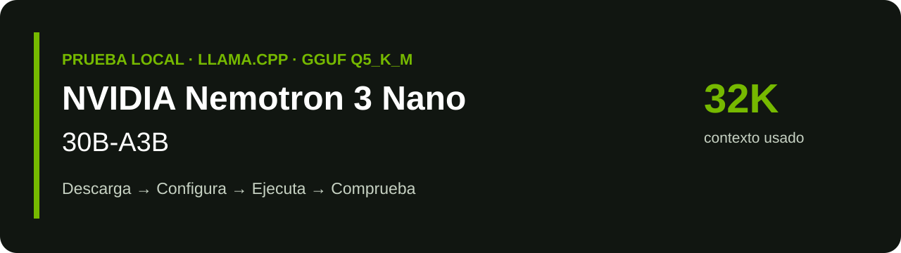

# NVIDIA Nemotron 3 Nano 30B-A3B



**El modelo del short, en tu equipo.** Guía en Windows / PowerShell para cargar el GGUF de Bartowski en `llama-server`, con la configuración aportada de la prueba local.

> [!IMPORTANT]
> **Configuración probada en el hardware indicado por el autor. No es una configuración universal ni oficial de NVIDIA.** Los resultados son observaciones aportadas de una ejecución; este repositorio no incluye una nueva validación de inferencia ni los logs originales.

| Modelo | Archivo utilizado | Contexto configurado | Ejecución |
| :--- | :--- | :--- | :--- |
| NVIDIA Nemotron 3 Nano 30B-A3B | GGUF Q5_K_M de Bartowski | 32.768 tokens | llama.cpp · CUDA · 2 GPU |

## Índice

- [Modelo y fuentes](#modelo-y-fuentes)
- [Setup de pruebas](#setup-de-pruebas)
- [Requisitos](#requisitos)
- [1 · Prepara llama.cpp](#1--prepara-llamacpp)
- [2 · Descarga el modelo](#2--descarga-el-modelo)
- [3 · Copia la configuración](#3--copia-la-configuración)
- [4 · Ejecuta y conversa](#4--ejecuta-y-conversa)
- [5 · Comprueba el rendimiento](#5--comprueba-el-rendimiento)
- [Qué hace cada bloque](#qué-hace-cada-bloque)
- [Problemas frecuentes](#problemas-frecuentes)
- [Referencias y reproducibilidad](#referencias-y-reproducibilidad)

## Modelo y fuentes

[NVIDIA Nemotron 3 Nano 30B-A3B — modelo oficial BF16](https://huggingface.co/nvidia/NVIDIA-Nemotron-3-Nano-30B-A3B-BF16) es un modelo de texto con arquitectura híbrida Mamba-Transformer y mezcla de expertos (MoE). NVIDIA describe **30.000 millones de parámetros totales y aproximadamente 3.500 millones activos por token**. El nombre A3B es la denominación del modelo; los parámetros activos no equivalen al tamaño total que debes cargar en memoria.

La ficha oficial anuncia hasta 1 millón de tokens de contexto. **Esta prueba utiliza 32.768**, no el máximo del modelo.

Para reproducir el short usamos la conversión de [Bartowski](https://huggingface.co/bartowski/nvidia_Nemotron-3-Nano-30B-A3B-GGUF), archivo exacto:

```text
nvidia_Nemotron-3-Nano-30B-A3B-Q5_K_M.gguf
```

Es una cuantización comunitaria para llama.cpp, distinta de los pesos BF16 oficiales. Consulta la licencia y las condiciones del modelo en sus repositorios de origen.

## Setup de pruebas

| Componente | Hardware |
| :--- | :--- |
| CPU | AMD Ryzen 9 5900X |
| RAM | 64 GB DDR4 · 3600 MT/s |
| GPU 1 | NVIDIA GeForce RTX 5070 · 12 GB |
| GPU 2 | NVIDIA GeForce RTX 5060 Ti · 16 GB |
| VRAM nominal total | 28 GB entre ambas GPU |

> [!NOTE]
> La memoria de las dos GPU no constituye un único bloque intercambiable. El reparto por capas, la memoria libre en cada tarjeta y los buffers influyen en lo que cabe. Comprueba qué tarjeta corresponde a `CUDA0` y a `CUDA1` antes de aplicar los márgenes de memoria.

## Requisitos

- Windows con PowerShell y controladores NVIDIA compatibles con ambas tarjetas.
- Build reciente de llama.cpp con backend CUDA y soporte para Nemotron, presets INI y las opciones de esta guía.
- Python y `pip` para la descarga con Hugging Face; o utiliza la alternativa con `curl.exe`.
- Espacio suficiente para el GGUF (aproximadamente 26 GB según Bartowski), los binarios y margen adicional para descargas/caché.
- RAM y VRAM suficientes para pesos, contexto y buffers. El setup anterior es la referencia probada; no se ha determinado aquí un mínimo universal.

## 1 · Prepara llama.cpp

Descarga los binarios **Windows x64 CUDA** de las [releases oficiales de llama.cpp](https://github.com/ggml-org/llama.cpp/releases). Extrae el paquete completo y, si la release los distribuye por separado, las bibliotecas CUDA requeridas. Conserva las DLL junto a los ejecutables según las instrucciones de esa release.

En PowerShell, sitúate en la carpeta que contiene `llama-server.exe`:

```powershell
Set-Location 'PEGA_AQUI_LA_CARPETA_DE_LLAMA_CPP'
.\llama-server.exe --version
.\llama-server.exe --list-devices
.\llama-server.exe --help
```

**Antes de seguir:** deben aparecer las dos GPU CUDA y las opciones `--models-preset`, `--fit-target`, `--reasoning-budget` y `--spec-type`. Si no aparecen, actualiza la build. Guarda la salida de `--version` para comparar pruebas.

## 2 · Descarga el modelo

Ejecuta desde la carpeta en la que quieras crear `models/`:

```powershell
python -m pip install --upgrade huggingface_hub
hf download bartowski/nvidia_Nemotron-3-Nano-30B-A3B-GGUF nvidia_Nemotron-3-Nano-30B-A3B-Q5_K_M.gguf --local-dir ./models
```

Alternativa sin Python, para descargar el mismo archivo directamente:

```powershell
New-Item -ItemType Directory -Force ./models | Out-Null
curl.exe -L --fail --retry 3 -C - -o "./models/nvidia_Nemotron-3-Nano-30B-A3B-Q5_K_M.gguf" "https://huggingface.co/bartowski/nvidia_Nemotron-3-Nano-30B-A3B-GGUF/resolve/main/nvidia_Nemotron-3-Nano-30B-A3B-Q5_K_M.gguf"
```

Espera a que finalice sin errores. Puedes registrar un hash local para identificar tu descarga:

```powershell
Get-FileHash './models/nvidia_Nemotron-3-Nano-30B-A3B-Q5_K_M.gguf' -Algorithm SHA256
```

Un hash local identifica el archivo; para verificar integridad, compáralo con el SHA256 publicado en los detalles del archivo de Hugging Face.

## 3 · Copia la configuración

Organización sugerida; el modelo y llama.cpp pueden estar en otras carpetas:

```text
NVIDIA-Nemotron-3-Nano-30B-A3B/
├── README.md
├── assets/
│   └── banner.svg
├── config/
│   └── nemotron-q5.ini
└── models/                         ← descarga local; no se sube a Git
    └── nvidia_Nemotron-3-Nano-30B-A3B-Q5_K_M.gguf
```

Abre [config/nemotron-q5.ini](config/nemotron-q5.ini). Sustituye **solo el placeholder del modelo** por la ruta completa al archivo `.gguf`. En el INI escribe la ruta sin comillas, incluso si contiene espacios. Puedes obtenerla así:

```powershell
(Resolve-Path './models/nvidia_Nemotron-3-Nano-30B-A3B-Q5_K_M.gguf').Path
```

La configuración aportada se conserva con estos valores. `spec-type=none` expresa speculative/MTP desactivado en la interfaz actual; no se configura un modelo draft. La sección y `version=1` son el envoltorio de preset de llama.cpp.

```ini
version = 1

[NVIDIA-Nemotron-3-Nano-30B-A3B]
model = PEGA_AQUI_LA_RUTA_DE_TU_MODELO
ctx-size = 32768
n-predict = -1
temp = 1.0
top-p = 0.95
frequency-penalty = 0
presence-penalty = 0
repeat-penalty = 1.0
batch-size = 512
ubatch-size = 128
parallel = 1
flash-attn = on
cache-type-k = q4_0
cache-type-v = q4_0
device = CUDA0,CUDA1
n-gpu-layers = auto
split-mode = layer
fit = on
fit-target = 1024,256
reasoning-budget = -1
spec-type = none
cache-prompt = on
no-mmproj = true
metrics = true
```

## 4 · Ejecuta y conversa

Desde la carpeta de `llama-server.exe`, sustituye el placeholder por la ruta completa al INI editado:

```powershell
.\llama-server.exe --models-preset 'PEGA_AQUI_LA_RUTA_DE_TU_INI' --host 127.0.0.1 --port 8080
```

Abre **http://127.0.0.1:8080** y selecciona `NVIDIA-Nemotron-3-Nano-30B-A3B`. El preset utiliza el modo router de llama.cpp: el modelo puede cargarse al realizar la primera petición. Espera a que termine la carga antes de valorar la velocidad.

`--host` y `--port` son ajustes de acceso local del ejemplo, añadidos a la configuración de inferencia. Mantén abierta la consola. Para detener el servidor, pulsa **Ctrl+C**.

Prueba también desde una segunda ventana de PowerShell:

```powershell
$body = @{
    model = 'NVIDIA-Nemotron-3-Nano-30B-A3B'
    messages = @(@{
        role = 'user'
        content = 'Explica en español qué es una mezcla de expertos, con un ejemplo sencillo.'
    })
    stream = $false
} | ConvertTo-Json -Depth 6

$response = Invoke-RestMethod -Uri 'http://127.0.0.1:8080/v1/chat/completions' -Method Post -ContentType 'application/json; charset=utf-8' -Body ([System.Text.Encoding]::UTF8.GetBytes($body))
$response.choices[0].message.content
$response.timings | Format-List
```

> [!TIP]
> Este prompt es una comprobación funcional nueva, no el prompt original del short. `n-predict=-1` y `reasoning-budget=-1` no fijan un límite de tokens de salida ni de razonamiento; la petición puede tardar. La generación sigue sujeta a final de secuencia, contexto y límites que imponga el cliente.

## 5 · Comprueba el rendimiento

| Observación inicial aportada | Velocidad aproximada |
| :--- | ---: |
| Generación de respuesta | **82,86 tokens/s** |
| Procesamiento del prompt | **401,27 tokens/s** |

**Una ejecución, no un benchmark agregado.** No son velocidades garantizadas. Varían con la longitud del prompt y la respuesta, caché, contexto ocupado, reparto de capas, carga de las GPU, drivers y versión de llama.cpp. Prompt processing y generación son fases diferentes: no se suman.

Para comparar con tu equipo:

1. Registra versión de llama.cpp, driver, hash del GGUF y GPU detectadas.
2. Usa siempre el mismo prompt y conserva su texto, el INI y los logs.
3. Separa la primera carga/calientamiento de las peticiones medidas.
4. Anota si la caché reutilizó el prompt; una petición con caché no es comparable a una sin caché.
5. Repite varias veces y conserva tokens, tiempos y velocidades de ambas fases. Los campos `timings` dependen de la versión; si no aparecen, consulta los logs del proceso que carga el modelo.

`metrics=true` habilita métricas compatibles con Prometheus. En modo router, la disponibilidad de métricas del modelo depende de la versión y del proceso servidor; no uses únicamente las métricas del router para inferir tokens/s del modelo.

## Qué hace cada bloque

| Bloque | Valores exactos | Para qué sirve |
| :--- | :--- | :--- |
| 📏 Contexto y salida | `ctx-size=32768` · `n-predict=-1` | Contexto solicitado de 32K; sin tope de generación fijado por este parámetro. |
| 🎲 Muestreo | `temp=1.0` · `top-p=0.95` | Controlan variación y selección de candidatos. Otros parámetros no listados conservan los valores de la build. |
| 🔁 Penalizaciones | `frequency-penalty=0` · `presence-penalty=0` · `repeat-penalty=1.0` | Valores neutros: no penalizan frecuencia, presencia ni repetición. |
| 📦 Lotes | `batch-size=512` · `ubatch-size=128` · `parallel=1` | Lote lógico de 512, microlote físico de 128 y un slot de procesamiento. |
| ⚡ Atención y KV | `flash-attn=on` · `cache-type-k=q4_0` · `cache-type-v=q4_0` | Flash Attention y caché KV cuantizada para reducir memoria; requiere soporte de la build/backend. No cambia la cuantización Q5 de los pesos. |
| 🖥️ Dos GPU | `device=CUDA0,CUDA1` · `n-gpu-layers=auto` · `split-mode=layer` | Selecciona ambas GPU, ajuste automático de capas y reparto por capas. No implica un reparto fijo 50/50. |
| 🧩 Ajuste de memoria | `fit=on` · `fit-target=1024,256` | Busca dejar margen de 1024 MiB en el primer dispositivo y 256 MiB en el segundo. No es un porcentaje ni una garantía de que el modelo quepa. |
| 💭 Razonamiento | `reasoning-budget=-1` | Sin presupuesto de razonamiento limitado por este ajuste; no desactiva el razonamiento. |
| 🚫 Speculative/MTP | `spec-type=none` · sin modelo draft | Desactiva la generación especulativa, incluido MTP. |
| 🗂️ Caché de prompt | `cache-prompt=on` | Permite reutilizar trabajo previo compatible; influye en mediciones repetidas. |
| 📝 Texto | `no-mmproj=true` | No carga automáticamente un proyector multimodal. |
| 📊 Métricas | `metrics=true` | Activa el endpoint de métricas del servidor. |

## Problemas frecuentes

| Síntoma | Revisión |
| :--- | :--- |
| Argumento desconocido / INI rechazado | Consulta `--help`; usa una build con esas opciones. No elimines parámetros en silencio si quieres comparar la misma configuración. |
| Solo aparece CPU o una GPU | Revisa paquete CUDA, DLL y drivers; repite `--list-devices`. |
| No encuentra el modelo | Pon la ruta completa del `.gguf` en `model`, sin comillas en el INI. |
| Error de memoria | Cierra aplicaciones que usen VRAM y comprueba memoria libre por tarjeta. Si reduces contexto o cambias caché/reparto, registra que es otra configuración. |
| Velocidad distinta a la del short | Compara versión, prompt, tokens, caché y logs; las cifras iniciales no son una promesa. |
| No carga al arrancar el router | Selecciona el preset y envía una petición; la carga puede ser bajo demanda. |

## Referencias y reproducibilidad

- [Modelo oficial de NVIDIA, BF16 y ficha técnica](https://huggingface.co/nvidia/NVIDIA-Nemotron-3-Nano-30B-A3B-BF16).
- [Conversión GGUF de Bartowski](https://huggingface.co/bartowski/nvidia_Nemotron-3-Nano-30B-A3B-GGUF).
- [Archivo Q5_K_M utilizado](https://huggingface.co/bartowski/nvidia_Nemotron-3-Nano-30B-A3B-GGUF/blob/main/nvidia_Nemotron-3-Nano-30B-A3B-Q5_K_M.gguf).
- [llama.cpp: servidor, argumentos y presets INI](https://github.com/ggml-org/llama.cpp/blob/master/tools/server/README.md).
- [llama.cpp: releases](https://github.com/ggml-org/llama.cpp/releases).
- [Hugging Face: descarga por CLI](https://huggingface.co/docs/huggingface_hub/guides/cli).

Referencias y formato de opciones revisados el **2 de octubre de 2026**. Los enlaces a `main`/`master` pueden cambiar. No se conoce la versión/commit exacto de llama.cpp, driver, hash, prompt ni logs originales de la ejecución observada: esta guía permite repetir el flujo y los parámetros aportados, pero no garantiza reproducir exactamente aquella cifra. Registra esos datos en tu nueva prueba.

Repositorio: [NVIDIA-Nemotron-3-Nano-30B-A3B](https://github.com/RicardoBertran/NVIDIA-Nemotron-3-Nano-30B-A3B). El banner es una pieza gráfica propia en verde y negro, sin implicar patrocinio de NVIDIA.

